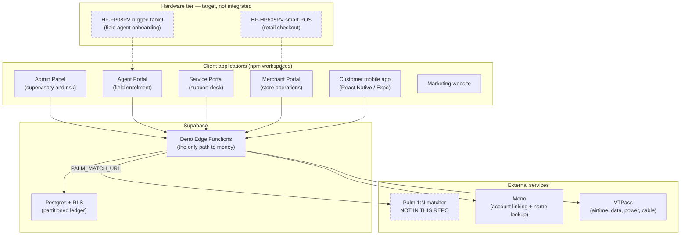
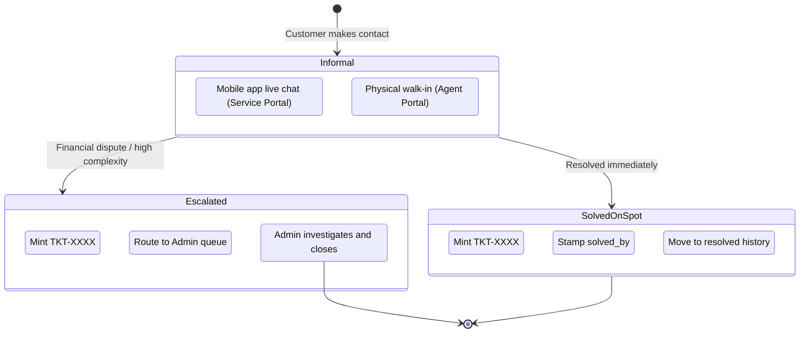

# MiliPay — Biometric Payments Infrastructure

<div align="center">


**Palm-vein authentication for direct bank-account payments in Nigeria**

[](#license)
[](#project-status)
[](#repository-layout)
[](#repository-layout)
[](#customer-mobile-app)
[](#the-money-path)

</div>

---

> **Read this first.** MiliPay is at seed stage and **is not in production, is not certified,
> and does not move real money yet.** Several components described in earlier versions of this
> document — the palm-matching microservice, the Android hardware bridge, and the Mono DirectPay
> debit leg — are **design targets that do not exist in this repository**.
> [Not built yet](#not-built-yet) is the authoritative list. Nothing in this README should be
> read as a claim of regulatory approval.

---

## Contents

- [What MiliPay is](#what-milipay-is)
- [Project status](#project-status)
- [Architecture](#architecture)
- [Repository layout](#repository-layout)
- [The money path](#the-money-path)
- [Portals and roles](#portals-and-roles)
- [Customer mobile app](#customer-mobile-app)
- [Bill payments and airtime](#bill-payments-and-airtime)
- [Support ticketing](#support-ticketing)
- [Security model](#security-model)
- [Secrets and environment](#secrets-and-environment)
- [Getting started](#getting-started)
- [Quality gates](#quality-gates)
- [Deployment](#deployment)
- [Not built yet](#not-built-yet)
- [Regulatory posture](#regulatory-posture)
- [License](#license)

---

## What MiliPay is

MiliPay is an **authentication and payment-initiation layer**, not a wallet and not a custodian
of customer funds. The intent is that a customer hovers their palm over a merchant POS terminal,
the palm identifies them, and their own bank account is debited over Open Banking rails — no
card, no phone, no cash.

The repository holds four role-based web portals, a public marketing site, a customer mobile app,
a shared React package, and a Supabase backend (Postgres + RLS + Deno Edge Functions).

---

## Project status

| Area | State | Notes |
| :--- | :--- | :--- |
| Staff auth and role separation | **Built** | Supabase Auth + RLS, five roles, enforced in DB and UI |
| Customer enrolment (agent / admin) | **Built** | Edge function mints identities; agent enrolments land as `pending` |
| Merchant onboarding | **Built** | Bank-account name lookup via Mono; falls back silently if unconfigured |
| POS terminal registry, blacklist, cascade delete | **Built** | `SECURITY DEFINER` RPC preserves transaction history |
| Support ticketing (two-tier) | **Built** | Ticket IDs minted only on resolve or escalate |
| KYC tiers, daily caps, PIN challenge | **Built** | Server-enforced in Edge Functions; client cannot bypass |
| Bill payments / airtime (VTU) | **Built** | VTPass fulfilment, Mono DirectPay collection, server-side pricing, refund queue |
| Bank account linking | **Built** | Mono account auth, max 3 active accounts per customer |
| Transaction ledger | **Built** | Monthly range partitions, auto-created by trigger |
| Palm capture (client) | **Partial** | Bridge contract + simulation gate exist; **no native bridge in this repo** |
| Palm matching (server) | **Partial** | Edge client exists and fails closed; **matcher service is not in this repo** |
| Card-present payment authorisation | **Partial** | Authenticates, matches, enforces limits, writes the ledger — **no bank is charged** |
| Settlement and payouts | **Not built** | Split is calculated and recorded, never disbursed |
| Identity verification (NIN/BVN) | **Not built** | Format-checked only; no NIMC/NIBSS verification call |
| Automated tests | **Not built** | Zero test files in the repository |

---

## Architecture



Dashed boxes are not implemented in this repository.

---

## Repository layout

```
BioPay/
├── packages/
│   └── shared/                # @milipay/shared — the only place business logic lives
│       └── src/
│           ├── components/    # UI primitives
│           ├── features/      # auth, customers, merchants, staff, support, biometrics
│           ├── lib/           # Supabase client, constants, helpers
│           ├── pages/         # Shared views, mounted by each portal
│           └── types/         # Domain models (single source of truth)
├── AdminPanel/                # Supervisory console
├── agent-portal/              # Field agent enrolment console
├── service-portal/            # Customer support desk
├── merchant-portal/           # Merchant store manager
├── website/                   # Public marketing site
├── mobile-app/                # React Native / Expo customer app (managed workflow)
├── supabase/
│   ├── functions/
│   │   ├── _shared/           # auth, limits, biometrics, providers — shared by all functions
│   │   ├── process-payment/   # Card-present authorisation
│   │   ├── vtu-service/       # Airtime, data, power, cable
│   │   ├── link-mono-account/ # Bank account linking
│   │   ├── onboard-merchant/  # Merchant registration + bank name lookup
│   │   ├── agent-register-user/
│   │   ├── approve-customer/ · reject-customer/
│   │   └── create-staff/ · delete-staff/
│   └── migrations/            # 22 migrations: schema, RLS, RPCs, hardening
├── scripts/
│   ├── scan-secrets.mjs       # Credential scanner (pre-commit + CI + history audit)
│   └── check-migrations.mjs   # BOM + PostgreSQL grammar check
├── .githooks/pre-commit       # Enabled automatically by `npm install`
└── .github/workflows/ci.yml   # Secret scan · typecheck and build · migrations parse
```

The four portals are thin shells. Nearly all screens come from `@milipay/shared`; each app's
Vite config aliases `@milipay/shared` to `packages/shared/src` and `@` to its own `src`.

---

## The money path

`process-payment` is the card-present authorisation endpoint. What it does today, in order:

1. **Authenticate the caller** against a Supabase JWT.
2. **Verify merchant ownership** — a merchant can only take payment for themselves.
3. **Check the terminal** is registered and active.
4. **Idempotency** — a repeated `reference` returns the original outcome instead of charging again.
5. **Match the palm** via `PALM_MATCH_URL`. This **fails closed**: with no matcher configured,
   every transaction is declined. An unverified palm must never move money.
6. **Enforce limits** — KYC tier single-transaction cap, cumulative daily cap, and a PIN
   challenge above the customer's configured threshold.
7. **Calculate the split** — platform fee (default 1.5%) against merchant net.
8. **Write the ledger.** A failed ledger write **declines the payment** rather than returning
   approved.

### What step 8 is not

The ledger row is the end of the line. **No bank API is called and no funds move.** The split in
the response is arithmetic recorded against the transaction, not a disbursement. Wiring the debit
leg and the payout leg is the single largest piece of outstanding work — see
[Not built yet](#not-built-yet).

### KYC tiers

Enforced server-side in `supabase/functions/_shared/limits.ts` and mirrored in
`packages/shared/src/types`. Daily totals reset at 00:00 WAT.

| Tier | Per transaction | Per day |
| :--- | ---: | ---: |
| Tier 1 | 50,000 NGN | 200,000 NGN |
| Tier 2 | 150,000 NGN | 500,000 NGN |
| Tier 3 | 250,000 NGN | 1,000,000 NGN |

### Currency invariant

**All monetary amounts are stored in Naira as `numeric(12,2)`. Never kobo.** Mono reports
balances in kobo and is converted once, at the boundary, in `link-mono-account`. `formatNaira`
must never divide by 100. This is a hard rule — see `GEMINI.md`.

---

## Portals and roles

Role boundaries are enforced twice: in Postgres RLS and again in the UI. RLS is the one that counts.

### Admin Panel — `role: admin`, `super_admin`
KYB review and merchant approval, commission rates, merchant blacklisting (which immediately
deactivates every paired terminal), cascade delete, fleet inventory, ledger audit.

Cascade delete decouples transactions with `merchant_id = NULL` rather than removing them, so the
financial audit trail survives a merchant being purged.

### Agent Portal — `role: agent`
In-person customer enrolment, merchant onboarding, terminal pairing, walk-in complaints.

Agents are **barred from transaction ledgers and merchant revenue** — enforced in RLS, not just
hidden in the UI. Customers enrolled by an agent land as `pending` and require admin approval;
customers enrolled by an admin are active immediately.

### Service Portal — `role: support`
Live chat from the mobile app, two-tier complaint resolution, customer and linked-account lookups.

### Merchant Portal — `role: merchant`
Store sales, terminal health, settlement records. **Not currently deployed** — it has no Firebase
hosting target.

---

## Customer mobile app

React Native on Expo SDK 57 (managed workflow), React 19, zustand, NativeWind.

Working: login, PIN setup, bank account linking through the Mono SDK, account limits, bill
payments and airtime, transaction history, support chat, profile settings.

There is **no `android/` or `ios/` directory** — the app is built through EAS, has no custom
native modules, and therefore cannot talk to palm-vein hardware. `BiometricSetupScreen` is a
visual mock: it animates, waits three seconds, and reports success without performing any
biometric check.

The app holds **no operator credentials**. `src/lib/vtuService.ts` is a thin client over the
`vtu-service` Edge Function; it does no pricing and no balance arithmetic.

---

## Bill payments and airtime

Mono DirectPay collects → the Mono webhook confirms → VTPass delivers. Built and covered by the
unit suite; **not yet proven end to end** against the Mono and VTPass sandboxes.

- **VTPass** — airtime, data, electricity, cable TV. The only gateway on the
  purchase, reconciliation and recovery paths.
- **Mono** — collects the customer's money from their linked bank account.
  `MONO_PAYMENT_MODE=directpay` (one-off authorisation per payment) is the
  default. Mono fixes each app's product at creation, so this takes **two**
  Mono apps: a Connect app for bank linking (`MONO_SECRET_KEY`) and a Payments
  app for DirectPay (`MONO_PAYMENTS_SECRET_KEY`). The webhook is registered on
  the Payments app.
- **Quick pay** — Mono Direct Debit mandates, off until
  `MONO_PAYMENT_MODE=mandate`. A customer approves MiliPay once per account
  (Settings → Linked Banks; Mono's page asks them to send ₦50 from that
  account), Mono's `events.mandates.ready` switches it on, and purchases from
  that account are then fingerprint-only. Per purchase, vtu-service uses the
  mandate when the account has an active one with allowance left and falls
  back to DirectPay otherwise — quick pay removes a step, never blocks one.
  The rules are in `supabase/functions/_shared/quick-pay.ts`; setup, status
  and switch-off are `supabase/functions/mono-mandate`. **Built against
  Mono's documentation, not yet run against Mono** — Direct Debit has to be
  enabled on the Payments app first. Refunds of a quick-pay debit are not yet
  proven: the refund queue calls Mono's DirectPay refund endpoint, which may
  not accept a mandate debit. If it does not, the refund exhausts its retries
  and lands as `refund_failed` for staff to settle — visible, not silent.
- **BigiSub** — parked. `supabase/functions/_shared/bigisub.ts` is still in the
  repository, but nothing live imports it and nothing reads `BIGISUB_*`. It was
  parked because no BigiSub purchase endpoint accepts a client-supplied
  reference, so an uncertain call could never be resolved by machine — a human
  had to check their dashboard. VTPass carries `request_id`, derived from the
  reference and the transaction's own timestamp, so every pending purchase can
  be requeried. `tests/gateway-isolation.test.ts` fails if anything on a money
  path, the mobile app or a portal refers to BigiSub again.

Pricing is resolved **server-side** from the operator catalogue with a configurable margin. The
client submits what it wants to buy, never what it costs.

Two separate pots move in a purchase: the customer's bank → MiliPay (Mono), then MiliPay's
pre-funded VTPass wallet → the operator. **The customer's money is confirmed before ours is
spent**, because airtime cannot be un-sold.

```
vtu-service   rate limit → price → ₦200 Mono floor → VTPass wallet check → tier/PIN limits
              → transaction row written as `initiated` → Mono debit initiated
mono-webhook  signature verified → replay rejected → amount checked → `paid`
vtu-service   `paid` → `fulfilling` → one VTPass /pay → delivered | pending | failed
vtu-reconcile every 2 min: requery pending purchases by request_id
              every 5 min: retry refunds with backoff (a queue, not a log line)
              every 15 min: flag anything stuck > 1 h; warn on a low VTPass wallet
```

A purchase call that times out is **pending, never failed**, and is never paid a second time:
VTPass may already have delivered, so the reconciler asks it with `requery` instead. A failure
queues a refund; a paid amount that disagrees with the priced one is quarantined for a person.
The transaction states are in `supabase/functions/_shared/vtu-state.ts`.

---

## Support ticketing

A formal ticket ID (`TKT-XXXX`) is minted **only on resolution or escalation**, so informal
conversations do not litter the queue with empty tickets.



---

## Security model

The design rule: **the client is never trusted with money, identity, or limits.** Everything that
matters happens in an Edge Function or a `SECURITY DEFINER` RPC.

**Every money endpoint authenticates.** `process-payment`, `vtu-service` and
`agent-register-user` validate a JWT and check the caller's role before doing anything.

**The ledger is server-authoritative.** `INSERT`, `UPDATE` and `DELETE` on `public.transactions`
are revoked from `authenticated` and `anon`. Clients read; only Edge Functions write.

**Column-level grants where RLS cannot reach.** RLS controls rows, not columns, so a customer who
could update their own row could set their own balance. `UPDATE` is revoked on
`linked_accounts` and `users` and re-granted per column — `is_active` on accounts,
`email`/`bvn`/`nin`/`is_verified` on users. Balance and KYC tier are not client-writable.

**Partitions are hardened individually.** `transactions` is range-partitioned by month and new
partitions are created by trigger. Partitions do **not** inherit parent privileges, so the
trigger function runs `SECURITY DEFINER` and revokes write access on each partition as it is
created — otherwise next month's data would be world-writable.

**PINs are real.** Hashed with `pgcrypto` (`crypt` + `gen_salt('bf')`), never stored or compared
in plaintext, weak values (`0000`, `1234`, …) rejected, and locked out after 5 failed attempts
for 15 minutes. The PIN threshold is set through a clamped RPC that cannot exceed the tier cap.

**Biometrics fail closed.** No matcher configured means every payment is declined. Simulated palm
captures carry a `SIMULATED-PVT-` prefix, are only produced in a dev build with
`VITE_ALLOW_BIOMETRIC_SIMULATION=true`, and are **refused at enrolment** outside simulation builds.

**Rate limiting** is a fixed-window counter in Postgres (`consume_rate_limit`), applied to
purchases and other abusable endpoints.

---

## Secrets and environment

Copy `.env.example` to `.env` and fill it in. **`.env` is git-ignored and must never be
committed.** `.env.example` is the authoritative contract — this README deliberately does not
duplicate variable values.

The rule that matters:

> Anything prefixed **`VITE_`** or **`EXPO_PUBLIC_`** is compiled into the client bundle and is
> readable by anyone who inspects the app. Operator and platform secrets must **only** be set as
> Supabase Edge Function secrets.

```bash
supabase secrets set MONO_SECRET_KEY=... VTPASS_API_KEY=...
```

Client-safe: `VITE_SUPABASE_URL`, `VITE_SUPABASE_ANON_KEY`, `VITE_ALLOW_BIOMETRIC_SIMULATION`.
The anon key is public by design and is only as strong as the RLS behind it.

Server-only: the service role key, `PALM_MATCH_*`, `MONO_*`, `VTPASS_*`, and notification
provider keys. (`BIGISUB_*` belongs to the parked adapter; nothing live reads it, but if it is
ever set it is server-only too, and the pre-commit secret scan still blocks it.)

`PALM_MATCH_URL` is **required** for card-present payments. Leaving it unset is safe — the
endpoint declines every transaction — but nothing will authorise until a matcher is reachable.

---

## Getting started

### Prerequisites

- Node.js 20.x (18+ works; CI runs 20)
- npm 9+
- Supabase CLI — local migrations and Edge Functions
- Firebase CLI — hosting deploys

### Install

```bash
git clone https://github.com/Alashabeeb/BioPay.git
cd BioPay
npm install
```

`npm install` also runs `git config core.hooksPath .githooks`, which enables the pre-commit secret
scan. Every clone gets it; nobody has to remember.

### Run a portal

```bash
npm --prefix AdminPanel run dev
```

Substitute `agent-portal`, `service-portal`, `merchant-portal` or `website`. None of the Vite
configs pin a port, so each one takes Vite's default (5173) and increments when that is busy —
watch the terminal for the actual URL.

### Run the mobile app

```bash
npm --prefix mobile-app start
```

### Build everything

```bash
for app in AdminPanel agent-portal service-portal merchant-portal website; do
  npm --prefix "$app" run build
done
```

---

## Quality gates

```bash
npm run scan-secrets          # every blob in every branch (full history audit)
npm run scan-secrets:staged   # what is about to be committed — this is the pre-commit hook
npm run check-migrations      # UTF-8 BOM check + PostgreSQL grammar parse
```

CI runs on every push to `main` and every pull request, in three jobs: **Secret scan**,
**Typecheck and build** (all five portals plus a mobile typecheck), and **Migrations parse**.

`.gitattributes` normalises line endings to LF, so a Windows editor cannot turn a two-word change
into a six-hundred-line diff.

**Limit of the migration check:** `pgsql-parser` validates the outer SQL grammar only. PL/pgSQL
bodies inside `$$ ... $$` are opaque string literals to it, so a logic error inside a function
body passes. **Apply migrations to a Supabase branch before production.**

---

## Deployment

Firebase Hosting, multi-target, configured in `firebase.json` and `.firebaserc`.

| Portal | Target | URL |
| :--- | :--- | :--- |
| Marketing website | `website` | https://milipay-website.web.app |
| Admin Panel | `admin` | https://milipay-adminportal.web.app |
| Agent Portal | `agent` | https://milipay-agentportal.web.app |
| Service Portal | `service` | https://milipay-serviceportal.web.app |
| Merchant Portal | — | **No hosting target configured** |

```bash
npx firebase-tools deploy --only hosting:admin,hosting:agent,hosting:service,hosting:website
```

The mobile app ships through EAS (`mobile-app/eas.json`); there is no local native build.

---

## Not built yet

An honest inventory. Everything here is absent or non-functional in this repository.

### Money movement

- **No customer debit.** `process-payment` never calls Mono DirectPay or any other rail. It
  authorises, records, and returns approved. No bank account is touched.
- **No settlement or payout.** The platform-fee split is computed and stored. Nothing disburses it.
  There is no transfers integration and no payout scheduler.
- **No webhooks, no reversal handshake.** Nothing listens for provider callbacks on the
  card-present path. (VTU has its own in-process reversal; that one is real.)
- **Merchant sub-accounts are fake.** `mono_subaccount_id` is generated locally as
  `mono_sub_<timestamp>_<random>`. No Mono sub-account is provisioned.
- **Balances are a one-time snapshot.** `linked_accounts.balance` is captured once when the
  account is linked and thereafter only decremented by VTU purchases. There is no refresh, no
  reconciliation against the bank, and card-present payments do not touch it. **It will drift.**

### Biometrics

- **No native bridge.** `palmScanner.ts` defines the `window.MiliPayPalmBridge` contract the
  Android shell is expected to inject. That shell does not exist here — there is no
  `PalmScannerModule.java`, no bundled HFSecurity SDK, no `android/` directory.
- **No matching service.** `PALM_MATCH_URL` is expected to point at a C++ 1:N matcher holding
  templates in RAM. That service is not in this repository. Until it exists, card-present
  payments decline by design.
- **No liveness enforcement.** The UI maps a `LIVENESS_ERROR` hint from the SDK, but nothing
  server-side verifies liveness.
- **Templates are stored as plaintext `text`.** `customers.palm_vein_template` is a `text`
  column, not `BYTEA`, and is not encrypted at the application layer.

### Identity and data protection

- **NIN and BVN are not verified.** They are regex-checked for 11 digits and stored. There is no
  NIMC, NIBSS or third-party identity call anywhere in the codebase.
- **Schema comments overstate encryption.** `users.bvn` and `users.nin` carry the comment
  "Encrypted at app level". They are not. Values are stored as cleaned digit strings.
  (`customers` stores only `nin_last_4`, which is better.)

### Engineering

- **No automated tests.** Zero test files. CI typechecks and builds; it does not verify behaviour.
- **Ticket IDs can collide.** `TKT-` plus a random four-digit number against a `UNIQUE` column
  gives 9,000 possible IDs and no retry on conflict.
- **Dev ports are not pinned.** Documentation elsewhere refers to ports 3000–3003; no Vite config
  sets them.
- **Notifications are unwired.** `RESEND_API_KEY` and `TERMII_API_KEY` are in the environment
  contract; no send path uses them.
- **Merchant portal is undeployed.** Builds fine, has no hosting target.

---

## Regulatory posture

**MiliPay holds no licence, certification or regulatory approval.** The items below describe what
the system is *designed against*, not what it has achieved.

- **CBN guidelines on biometrics in payment systems** — tier limits, PIN step-up above a
  threshold, and a preserved audit trail are implemented against these requirements. Nothing has
  been reviewed or approved by the Central Bank of Nigeria.
- **Nigeria Data Protection Act** — the architecture keeps biometric templates inside
  infrastructure MiliPay controls rather than a vendor cloud, and the matcher is designed to run
  on MiliPay's own hardware. As noted above, templates and identity numbers are **not yet
  encrypted at rest beyond what Postgres provides**. This gap must close before any live data.
- **EMV / PCI-PTS** — properties of the target POS hardware (`HF-HP605PV`), not of this software.
  No PCI assessment has been performed.

Target hardware for a future integration: `HF-FP08PV` rugged tablet for field agents,
`HF-HP605PV` certified POS for retail, `HF-VP930Pro` USB module for development and benchmarking.
None is integrated today.

---

## License

Copyright © 2026 MiliPay Ltd. All rights reserved. Proprietary software.
