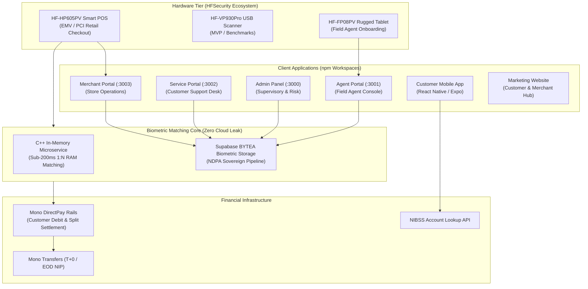
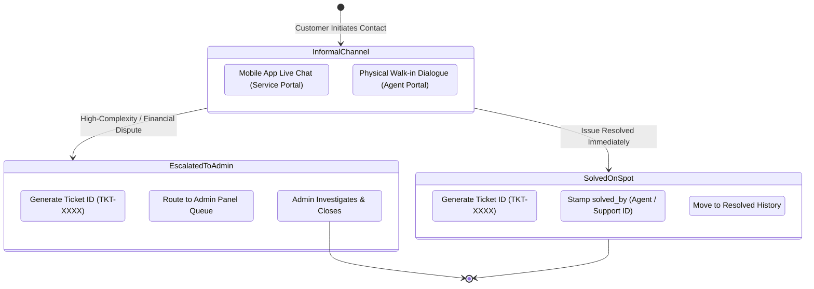

# MiliPay — Biometric Financial Switch

<div align="center">


**Payments in Milliseconds • Sovereign Biometric Financial Infrastructure**

[](#)
[](#)
[](#)
[](#)
[](#)
[](#)
[](#)

</div>

---

## Executive Summary

**MiliPay** is an enterprise-grade biometric financial switch engineered for emerging markets, starting with Nigeria. It bridges physical identity and digital banking by combining dual-lens near-infrared (NIR 850nm) + RGB subcutaneous palm vein scanning with Open Banking payment rails (powered by **Mono DirectPay**).

MiliPay enables consumers to make retail store payments in **under 450 milliseconds** simply by hovering their palm over a certified merchant POS terminal—completely cardless, phoneless, and cash-free.

---

## System Architecture



---

## Biometric Hardware Strategy & Tiering

Under Central Bank of Nigeria (CBN) regulations and the Nigeria Data Protection Act (NDPA), all biometric operations strictly adhere to **data sovereignty**. Biometric templates are never streamed to foreign cloud demo servers. MiliPay utilizes HFSecurity hardware integrated with private on-premise local SDK libraries.

| Device Tier | Model | OS & Certifications | Target Role | Key Capabilities |
| :--- | :--- | :--- | :--- | :--- |
| **Field Agent Handheld** | `HF-FP08PV` | Android 13 • IP65 | Field Agents (`role: 'agent'`) | 10,000mAh battery, 4G LTE, OCR/MRZ camera for NIN/Passport, built-in dual NIR/RGB palm scanner. Roaming customer enrollment. |
| **Development & Benchmark** | `HF-VP930Pro` | Multi-OS (Android / Linux / Windows) | MVP & C++ Benchmarks | USB Type-C module for algorithm tuning, RAM matching benchmarks, and local rapid testing. |
| **Primary Merchant POS** | `HF-HP605PV` | Android 11 • **EMV & PCI-PTS Certified** | Retail Merchants (`role: 'merchant'`) | Mandatory CBN financial certification, 6.0" IPS touchscreen, 3000mAh battery, built-in thermal printer, ≤450ms biometric recognition. |
| **Budget POS Terminal** | `HF-MP50` | Android 11 | Secondary / Tier-2 Retail | 5.5" display, 1800mAh battery, lower-cost alternative where PCI/EMV is not strictly mandated. |
| **Future Enterprise** | Desktop & Floor Kiosks | Industrial Linux / Android | Supermarket Chains | Self-checkout kiosks with 58/80mm thermal receipt printers and integrated palm sensors (Shoprite, Spar, Ebeano). |

### Biometric SDK Pipeline
- **Android Native Bridge (`PalmScannerModule.java`)**: Wraps `palm-android-sdk-v1.3.7.jar`.
  - Lifecycle: `PalmSdk.initialize()` &rarr; `Device.create()` &rarr; `mDevice.open()` &rarr; `createStream(StreamType.RGB_IR)` &rarr; `start()`.
  - Capture: `mDevice.capturePalm(callback, timeout)` extracts raw byte arrays: `irFeature`, `rgbFeature`, `score`, `palmType` (`0: left, 1: right`).
  - Real-Time Hardware Prompts: Maps SDK feedback to UI guidance (`NO_PALM_DETECTED`, `IR_DARKNESS` &rarr; move closer, `IR_OVER_EXPOSE` &rarr; move away, `PALM_IS_MOVING` &rarr; keep still).
  - Hardware Status LEDs: `LED_GREEN_MODE` on approval, `LED_RED_MODE` on decline, `LED_BLUE_BREATH_MODE` during biometric acquisition.
- **Sovereign In-Memory Matching Engine**: Sovereign C++ Microservice utilizing the Linux SDK (`vp930-sdk-linux-x86_64-v1.3.58-P`). Loads biometric templates as `BYTEA` arrays into memory as `std::vector<float>` and executes `CompareFeaturesScore` in **<200ms** across the customer base.

---

## Monorepo Architecture & Workspaces

MiliPay is structured as an **npm workspace monorepo** to enforce clean boundaries between shared business logic and independent frontend applications.

```
BioPay/
├── packages/
│   └── shared/                # Core shared package (@milipay/shared)
│       ├── src/
│       │   ├── components/    # Reusable UI primitives (Buttons, Modals, Cards, Tables)
│       │   ├── features/      # Business services (auth, customers, merchants, staff)
│       │   ├── lib/           # Supabase client, constants, helpers
│       │   ├── pages/         # Shared views (Login, Customers, Complaints, Merchants)
│       │   └── types/         # Master TypeScript domain models & schemas
├── AdminPanel/                # Central Supervisory Command (:3000)
├── agent-portal/              # Field Agent Roaming Console (:3001)
├── service-portal/            # Customer Support & Live Desk (:3002)
├── merchant-portal/           # Merchant Store Manager (:3003)
├── website/                   # Public Marketing & Onboarding Portal
├── mobile-app/                # React Native / Expo Customer Application
├── supabase/                  # PostgreSQL schemas, migrations, Edge Functions
│   ├── functions/
│   │   ├── onboard-merchant/  # Merchant registration & NIBSS bank verification
│   │   ├── process-payment/   # Palm matching, Mono DirectPay split debit
│   │   └── link-mono-account/ # Token exchange & bank account linking
│   └── migrations/            # Production migrations & RLS security policies
└── firebase.json              # Multi-target Firebase Hosting deployment
```

---

## Portal Roles & Separation of Responsibilities

MiliPay strictly enforces role boundaries across four web portals:

### 1. Field Agent Portal (`agent-portal` — Port 3001)
- **Role**: `role: 'agent'`
- **Target Hardware**: Rugged Handheld Tablet (`HF-FP08PV` / `VP930Pro`).
- **Responsibilities**:
  - Roaming in-person customer enrollment (NIN verification, palm vein capture).
  - Physical merchant onboarding and terminal pairing (`TID`).
  - Handling physical walk-in customer complaints on the spot.
- **Security Privacy Restriction**: Field Agents are **strictly barred** from viewing merchant financial transactions or terminal revenue ledgers (enforced at both PostgreSQL RLS and UI layers).

### 2. Service Portal (`service-portal` — Port 3002)
- **Role**: `role: 'support'`
- **Target Hardware**: Support Staff Workstation.
- **Responsibilities**:
  - Managing omnichannel live chats originating from the customer Mobile App.
  - Two-tier complaint resolution (Tier-1 instant solve vs. Tier-2 administrative escalation).
  - Customer profile and linked banking status lookups.

### 3. Admin Panel (`AdminPanel` — Port 3000)
- **Role**: `role: 'admin'`, `role: 'super_admin'`
- **Target Hardware**: Central Master Console.
- **Responsibilities**:
  - KYB compliance reviews, merchant approvals, and commission rates.
  - Emergency security controls: **Blacklist Merchant** (instantly locks down all paired POS hardware) and **Cascade Delete** (cleans up terminals and decouples historical transactions with `merchant_id = NULL` to preserve CBN financial audit trails).
  - Fleet management and POS hardware inventory tracking.
  - Master settlement ledger auditing and platform revenue reconciliation.

### 4. Merchant Portal (`merchant-portal` — Port 3003)
- **Role**: `role: 'merchant'`
- **Target Hardware**: Desktop / Tablet Store Management.
- **Responsibilities**:
  - Real-time store sales tracking and transaction telemetry.
  - POS terminal fleet health monitoring (HP605PV / HF-MP50 heartbeats).
  - Mono DirectPay settlement ledger and automated payout records (98.5% net settlement).

---

## Two-Tier Ticketing Architecture

Customer dispute resolution follows a strict two-tier lifecycle where a formal ticket ID (`TKT-XXXX`) is generated **only upon resolution or escalation**, avoiding orphaned empty tickets.



---

## Open Banking & Settlement Architecture (Mono)

MiliPay leverages **Mono** as its primary Open Banking and payment rail in Nigeria:

1. **Merchant Verification**: Before activation, merchant settlement bank accounts are validated in real-time against the national NIBSS switch via Mono's Account Lookup API (`/v2/lookup/account`).
2. **Split Payments**: Each merchant is provisioned a Mono Sub-Account (`mono_subaccount_id`). Customer debits via Mono DirectPay automatically execute a split:
   - **98.5%** &rarr; Merchant Settlement Account.
   - **1.5%** &rarr; MiliPay Platform Take-Rate Revenue Account.
3. **Automated Disbursements**: Instant (T+0) or Daily EOD batch NIP transfers via Mono Transfers API directly to merchant commercial bank accounts.
4. **Idempotency & Reversals**: Every payment request enforces a unique idempotency reference (`reference`). Two-way webhook handshakes trigger Mono's automated reversal engine if bank switches experience mid-flight timeouts.
5. **High-Value PIN Safeguard**: Transactions exceeding the customer-defined security threshold (e.g. > ₦5,000) require the customer to enter their 4-digit PIN on the terminal before triggering the Mono DirectPay debit.

---

## Database Security & PostgreSQL RLS Policies

All database access is secured by strict Row Level Security (RLS) policies:

- **Transactions Table (`public.transactions`)**:
  - `SELECT` is restricted to `admin`, `super_admin`, and `support` roles. Field Agents (`role: 'agent'`) have **zero read permissions** on transaction ledgers.
  - `merchant_id` allows `NULL` with `ON DELETE SET NULL` to preserve historical records if a merchant is deleted.
- **Merchants Table (`public.merchants`)**:
  - Statuses supported: `'pending'`, `'active'`, `'suspended'`, `'blacklisted'`.
  - `DELETE` is restricted to `admin` and `super_admin`.
- **POS Terminals Table (`public.pos_terminals`)**:
  - Terminals maintain a foreign key to `merchants.id` (`ON DELETE CASCADE`).
  - Terminal blacklisting sets `is_active = false` immediately halting biometric capture.
- **Cascade Purge Function (`delete_merchant_cascade`)**:
  - `SECURITY DEFINER` stored procedure that decouples transaction records, removes terminals, purges the merchant profile, and deletes linked authentication records.

---

## Getting Started

### Prerequisites
- **Node.js**: `v18.0.0+` (Recommended: `v20.x`)
- **npm**: `v9.0.0+`
- **Supabase CLI**: For local Edge Function testing and migrations
- **Firebase Tools**: For hosting deployments (`npm install -g firebase-tools`)

### Installation

```bash
# Clone the repository
git clone https://github.com/Alashabeeb/BioPay.git
cd BioPay

# Install all workspace dependencies
npm install
```

### Environment Configuration

Create a `.env` file in the root or individual portal directories:

```env
# Supabase Configuration
VITE_SUPABASE_URL=https://your-project.supabase.co
VITE_SUPABASE_ANON_KEY=your-anon-key
SUPABASE_SERVICE_ROLE_KEY=your-service-role-key

# Mono Open Banking
MONO_PUBLIC_KEY=test_pk_...
MONO_SECRET_KEY=test_sk_...
MONO_WEBHOOK_SECRET=your_webhook_secret

# Platform Configuration
VITE_PLATFORM_FEE_PERCENTAGE=1.5
```

### Development Servers

Run individual portals independently:

```bash
# Admin Panel (Port 3000)
npm --prefix AdminPanel run dev

# Field Agent Portal (Port 3001)
npm --prefix agent-portal run dev

# Customer Service Portal (Port 3002)
npm --prefix service-portal run dev

# Merchant Store Portal (Port 3003)
npm --prefix merchant-portal run dev

# Marketing Website
npm --prefix website run dev

# Customer Mobile App (Expo)
npm --prefix mobile-app start
```

### Production Builds

```bash
# Build all web applications
npm --prefix AdminPanel run build
npm --prefix agent-portal run build
npm --prefix service-portal run build
npm --prefix merchant-portal run build
npm --prefix website run build
```

---

## Deployment & Hosting

The web applications are deployed to **Firebase Hosting** with multi-target configurations defined in `firebase.json` and `.firebaserc`:

| Portal | Target Name | Production Hosting URL |
| :--- | :--- | :--- |
| **Marketing Website** | `website` | [https://milipay-website.web.app](https://milipay-website.web.app) |
| **Admin Panel** | `admin` | [https://milipay-adminportal.web.app](https://milipay-adminportal.web.app) |
| **Field Agent Portal** | `agent` | [https://milipay-agentportal.web.app](https://milipay-agentportal.web.app) |
| **Service Portal** | `service` | [https://milipay-serviceportal.web.app](https://milipay-serviceportal.web.app) |

To deploy active portals:

```bash
# Deploy website, admin, agent, and service portals
npx firebase-tools deploy --only hosting:admin,hosting:agent,hosting:service,hosting:website
```

---

## Regulatory Compliance & Certifications

- **CBN Guidelines on Biometrics in Payment Systems**: 100% compliant with Central Bank of Nigeria requirements for transaction authorization, dispute resolution timelines, and biometric liveness.
- **Nigeria Data Protection Act (NDPA)**: Bank-grade encryption for biometric templates in transit (TLS 1.3, AES-256) and at rest (`BYTEA` format in sovereign private infrastructure).
- **EMV & PCI-PTS**: Hardware-level security standards enforced on merchant POS terminals (`HF-HP605PV`).

---

## License

Copyright &copy; 2026 MiliPay Ltd. All rights reserved. Proprietary software.
